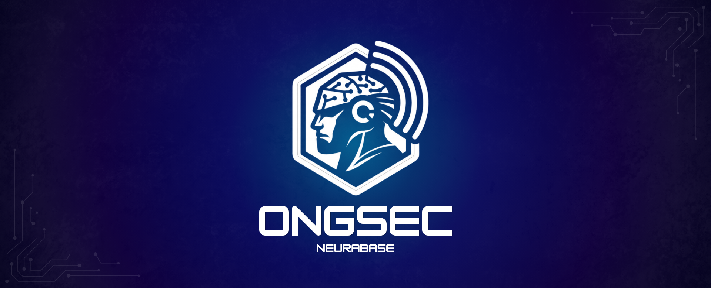
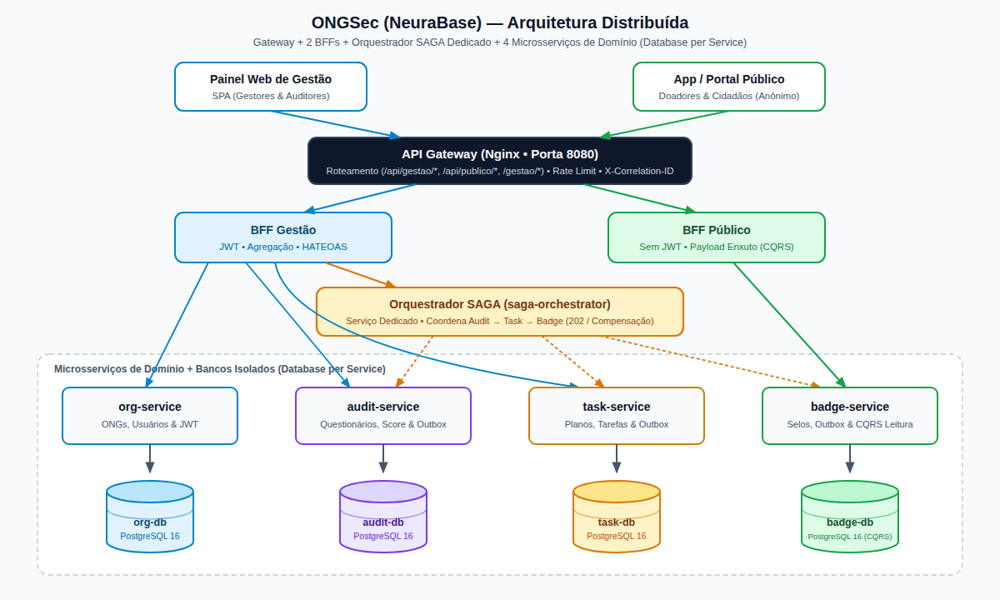

<p align="center">
  
</p>

<p align="center">
  
  
  
  
  
</p>

<h3 align="center">
  Startup de Cibersegurança e Conformidade LGPD para o Terceiro Setor e Pequenos Negócios
</h3>

---

## Integrantes (Equipe NeuraBase)

<div align="center">

| [<br /><sub><b>Lucas J.</b></sub>](https://github.com/lucasjesus682) | [<br /><sub><b>Marco A.</b></sub>](https://github.com/marco2299) | [<br /><sub><b>Nicolas M.</b></sub>](https://github.com/nicolas-mtheus) | [<br /><sub><b>Tainara F.</b></sub>](https://github.com/tainarafms) |
| :---: | :---: | :---: | :---: |

</div>

---

## 🚀 Execução Rápida do Sistema Completo

Com a entrega da **Parte 4 (Sistema em Funcionamento & Integração de LLM)**, a plataforma inteira sobe localmente com um **único comando**, orquestrando **16 containers** (Gateway, 2 BFFs, 2 frontends, Redis, Orquestrador SAGA dedicado, Serviço de IA com RAG + LangChain + Ollama, 4 microsserviços de domínio e 4 bancos PostgreSQL independentes):

```bash
# Na raiz do repositório (a única porta publicada por padrão é a 8080; para usar outra porta, defina GATEWAY_PORT=8085):
docker compose -f infra/compose/docker-compose.yml up --build -d
```

### 🤖 Pré-requisito de IA Local (Ollama)
- O `ai-service` conecta ao **Ollama** rodando no host via `http://host.docker.internal:11434` usando por padrão o modelo **`deephat:latest`** (configurável por `OLLAMA_BASE_URL` e `OLLAMA_MODEL`).
- Para respostas ao vivo do modelo local:
  ```bash
  ollama pull deephat:latest
  OLLAMA_HOST=0.0.0.0:11434 ollama serve
  ```
- Caso o Ollama não esteja ativo no ambiente de teste, a plataforma continua funcionando normalmente e o `ai-service` aciona o **Fallback Resiliente** contextualizado (RAG + LangChain Tools) sem travar os fluxos.

### 🌐 Endereços de Acesso (Única Porta Exposta: `8080` ou `${GATEWAY_PORT}`)

| Recurso | URL | Descrição |
|---|---|---|
| **Painel Web de Gestão** | [`http://localhost:8080/gestao/`](http://localhost:8080/gestao/) | Interface SPA com controle de perfil RBAC (`GESTOR` limpo / `ADMIN` técnico) |
| **Portal Mobile Público (PWA)** | [`http://localhost:8080/publico/`](http://localhost:8080/publico/) | Consulta pública anônima (CQRS) de ONGs certificadas e selo verificável |
| **Healthcheck de Borda** | [`http://localhost:8080/healthz`](http://localhost:8080/healthz) | Verificação de integridade do Nginx Gateway (HTTP 200) |
| **Consulta Pública de Selo (API)** | [`http://localhost:8080/api/publico/selos/ong-123`](http://localhost:8080/api/publico/selos/ong-123) | Rota anônima via BFF Público (CQRS de leitura) |

#### 🔑 Credenciais para Demonstração no Painel Web
- **Perfil `GESTOR` (Associação Cuidar — `ong-123`):** `maria@associacaocuidar.org` / `senha-segura-123` *(ou crie uma nova ONG em "Cadastrar Nova ONG" / clique em "⚡ Preencher Gestor Demo")*
- **Perfil `ADMIN` (Monitoramento Técnico, SAGA, Bancos & Debug IA):** `admin@gmail.com` / `admin123` *(configurável via variável `ADMIN_DEFAULT_PASSWORD`)*

---

## O Problema e Motivação
Comércios locais e associações sem fins lucrativos (ONGs) lidam diariamente com dados altamente sensíveis — desde registros de doadores e fichas médicas até endereços de populações em extrema vulnerabilidade social. No entanto, por restrições orçamentárias e falta de equipes técnicas, essas entidades recorrem a processos inseguros (troca de documentos via aplicativos de mensagem sem criptografia, planilhas compartilhadas sem controle de acesso ou senhas padrão). 

Com a vigência da **Lei Geral de Proteção de Dados (LGPD - Lei nº 13.709/2018)** e o avanço das sanções operacionais pela ANPD, a ausência de higiene cibernética expõe essas instituições a riscos severos de vazamento de dados, perda de credibilidade e inviabilização de suas atividades.

---

## Impacto Social Esperado
Democratizar o acesso à segurança da informação e à conformidade regulatória no Terceiro Setor por meio de uma plataforma automatizada, didática e de baixo custo.

* **Beneficiários:** Gestores de ONGs, pequenos comerciantes, doadores e assistidos por projetos sociais.
* **Resultados Esperados:** Mitigação do risco de vazamento de dados sensíveis de populações vulneráveis, aumento da transparência institucional e fortalecimento da confiança de doadores.
* **Métricas de Impacto:** Número de entidades auditadas, índice médio de evolução no *score* de conformidade e total de selos válidos emitidos e verificados publicamente.

---

## A Solução e História de Uso
O **ONGSec** atua como um consultor de segurança automatizado e emissor de selos digitais de conformidade cibernética.

**Exemplo Prático (Associação Cuidar):**
1. **Diagnóstico Automatizado:** Dona Maria, diretora de um abrigo infantil, acessa o **Painel Web de Gestão** e responde a um questionário adaptado de higiene digital.
2. **Plano de Ação Tático:** O sistema processa as vulnerabilidades e gera um plano de tarefas de remediação prioritárias.
3. **Automação com IA (RAG + LangChain):** Ao executar a tarefa *"Elaborar Política de Privacidade"*, Dona Maria aciona o **Assistente IA**. O modelo recupera diretrizes oficiais da ANPD (RAG) e consulta as configurações reais da ONG no sistema via *tools* internas para gerar a política personalizada.
4. **Validação e Selo Digital:** Após a resolução das pendências e atualização do *score*, o sistema aciona uma orquestração **SAGA** para emitir o Selo Digital de Conformidade.
5. **Transparência Pública:** Semanas depois, um doador abre o **App/Portal Mobile Público** para validar a reputação digital da ONG. A consulta utiliza uma arquitetura **CQRS** otimizada para respostas instantâneas e não exige login.

---

## Arquitetura Distribuída & Containerização

O sistema utiliza o padrão de **Microsserviços com Database per Service** (cada serviço possui sua própria instância isolada de banco de dados). O tráfego externo entra sempre pelo API Gateway antes de alcançar o BFF correspondente.



### 🐳 1. Docker e Dockerfiles Customizados
- **Dockerfile próprio para cada serviço:** Nenhum dos 11 serviços construídos utiliza imagens prontas de terceiros sem customização.
- **Multi-Stage Build nos Frontends (`frontend/web-gestao/Dockerfile` e `frontend/mobile-publico/Dockerfile`):**
  - **Estágio 1 (Builder):** Ambiente `node:20-alpine` para montagem dos artefatos estáticos.
  - **Estágio 2 (Produção):** `nginx:alpine` mínimo servindo apenas `/dist`.
  - **Ganho Arquitetural:** Redução superior a 90% no tamanho da imagem final (~300MB para ~25MB), eliminação de ferramentas de build em runtime e mitigação de vulnerabilidades.
- **Serviços Backend em Python:** Imagens enxutas baseadas em `python:3.11-slim` (BFFs) e `python:3.12-slim` (microsserviços, orquestrador SAGA e IA), dependências instaladas com `--no-cache-dir` e cache de camadas otimizado.

### 🔌 2. API Gateway e BFFs (Backend-for-Frontend)
- **API Gateway (Nginx):**
  - Porta `8080` (ou `${GATEWAY_PORT}`) mapeada para a porta `80` do container. Única porta HTTP publicada pelo Compose.
  - Roteamento reverso inteligente: `/gestao/` para o Painel Web, `/publico/` para o Portal Mobile PWA, `/api/gestao/*` para o BFF Gestão e `/api/publico/*` para o BFF Público.
  - Verificação de saúde de borda na rota `GET /healthz`.
  - Rate limiting e rastreabilidade distribuída via header `X-Correlation-ID`.
- **BFF Gestão (`bff-gestao`):** Porta interna `8000`. Exige JWT válido em rotas protegidas (com revogação de `jti` no Redis), impõe RBAC (`GESTOR` vs `ADMIN`), agrega múltiplos serviços e injeta controles hipermidiáticos HATEOAS.
- **BFF Público (`bff-publico`):** Porta interna `8000`. Consulta anônima de selos e busca de ONGs certificadas via CQRS otimizado para cidadãos e doadores.

### 💾 3. Persistência e Isolamento de Redes (Compose)
- **5 Volumes Nomeados:** `org_db_data`, `audit_db_data`, `task_db_data`, `badge_db_data` e `saga_db_data`, assegurando persistência durável dos 4 bancos PostgreSQL 16 e do histórico SQLite do `saga-orchestrator`.
- **6 Redes Definidas com Isolamento Estrito:**
  - `edge`: Conecta o `gateway` aos BFFs (`bff-gestao`, `bff-publico`) e frontends (`web-gestao`, `mobile-publico`).
  - `app`: Conecta BFFs, `redis`, `saga-orchestrator`, `ai-service` e os 4 microsserviços de domínio.
  - `org-data`, `audit-data`, `task-data`, `badge-data` (`internal: true`): Redes privadas exclusivas entre cada microsserviço e seu respectivo PostgreSQL, garantindo no nível de rede que nenhum serviço acesse o banco alheio.

### ☸️ 4. Orquestração em Kubernetes (`infra/kubernetes/`)
- **Deployments & Services:** Manifestos declarativos com réplicas, `livenessProbe` e `readinessProbe` baseados em `/healthz`. Services com ClusterIP e mapeamento dual-port (80 e 8000).
- **Ingress Controller:** Roteamento de borda unificado em [`infra/kubernetes/networking/ingress.yaml`](infra/kubernetes/networking/ingress.yaml).
- **ConfigMaps e Secrets:** Variáveis públicas centralizadas em [`infra/kubernetes/config/app-config.yaml`](infra/kubernetes/config/app-config.yaml) e credenciais protegidas via Kubernetes Secrets geradas pelo script [`infra/kubernetes/config/create-local-secrets.sh`](infra/kubernetes/config/create-local-secrets.sh).
- **Demonstração de Escalabilidade:** Suporte a escalabilidade horizontal via HPA ([`infra/kubernetes/workloads/bff-publico-hpa.yaml`](infra/kubernetes/workloads/bff-publico-hpa.yaml)) ou sob demanda via `kubectl scale deployment bff-publico -n ongsec --replicas=3`.

---

## Padrões e Requisitos Transversais

* **SAGA Orquestrada (Transação Distribuída):** O fluxo de Solicitação e Emissão de Selo é coordenado por um serviço dedicado (**`saga-orchestrator`**) fora dos microsserviços de domínio, cruzando `audit-service` → `task-service` → `badge-service`. Detalhes em [`docs/saga.md`](docs/saga.md).
* **CQRS:** O `badge-service` separa o modelo de escrita do modelo de consulta pública. Detalhes em [`docs/cqrs.md`](docs/cqrs.md).
* **Persistência:** Database-per-service e outbox detalhados em [`docs/data-consistency.md`](docs/data-consistency.md).
* **Inteligência Artificial (Parte 4 — RAG + LangChain + Ollama):** O `ai-service` integra o modelo local `deephat:latest` via **Ollama** com pipeline completo de **RAG** (base normativa ANPD, CERT.br, CIS IG1, SEBRAE e regras ONGSec), **LangChain** (chains LCEL + 3 tools consultando dados reais dos microsserviços) e resiliência distribuída (Circuit Breaker, Timeout+Retry com Backoff, Cache e Fallback). Avaliação completa em [`docs/rag-avaliacao.md`](docs/rag-avaliacao.md) e análise de resiliência, latência e custo em [`docs/llm-resiliencia-latencia-custo.md`](docs/llm-resiliencia-latencia-custo.md).

---

## Contratos REST e Convenções de API

Todos os serviços internos e BFFs seguem contratos REST explícitos, versionados e padronizados:

* **Versionamento na URI (`/v1`):** Todos os microsserviços internos versionam seus recursos no caminho (ex.: `GET /v1/organizacoes/{ongId}`). Alterações incompatíveis geram `/v2` sem quebra silenciosa. Na borda, o API Gateway expõe `/api/gestao/*` e `/api/publico/*` para os BFFs.
* **Semântica HTTP e Códigos de Status:**
  * `200 OK` (leitura/transição), `201 Created` (criação com `Location`), `202 Accepted` (início assíncrono da SAGA em `POST /v1/solicitacoes`), `204 No Content` (encerramento de sessão).
  * Erros padronizados em **RFC 7807 (`application/problem+json`)** com `type`, `title`, `status` e `detail`: `400`, `401`, `403`, `404`, `409` (conflito de estado) e `422` (regra de negócio recusada).
* **Cabeçalhos Transversais:**
  * `X-Correlation-ID`: gerado/propagado pelo API Gateway em todas as requisições e eventos para rastreabilidade distribuída.
  * `Idempotency-Key`: obrigatório em operações de escrita críticas (`POST` de solicitação, compensação, conclusão, reabertura e revogação), garantindo que retries não dupliquem selos ou tarefas.
* **HATEOAS (`_links`):** Recursos navegáveis (`Tarefa`, `SolicitacaoSelo` e detalhes no BFF Gestão) retornam `_links` indicando as próximas ações válidas.

### Mapa de Endpoints Principais

| Camada / Serviço | Método & Rota | Descrição | Contrato Detalhado |
|---|---|---|---|
| **BFF Público** *(via Gateway)* | `GET /api/publico/selos/{ongId}` | Consulta anônima do selo (CQRS) | [`docs/api/alinhamento-bff.md`](docs/api/alinhamento-bff.md) |
| **BFF Gestão** *(via Gateway, JWT)* | `POST /api/gestao/sessoes` | Login e emissão de JWT | [`docs/gateway-bffs.md`](docs/gateway-bffs.md) |
| **BFF Gestão** *(via Gateway, JWT)* | `GET /api/gestao/selos/{ongId}/detalhes` | Visão agregada + `_links` HATEOAS | [`docs/api/alinhamento-bff.md`](docs/api/alinhamento-bff.md) |
| **BFF Gestão** *(via Gateway, `ADMIN`)* | `POST /api/gestao/selos/{ongId}/revogar` | Revogação administrativa de selo | [`docs/api/alinhamento-bff.md`](docs/api/alinhamento-bff.md) |
| **BFF Gestão — IA** *(via Gateway, JWT)* | `POST /api/gestao/ia/consultoria` · `/comparar-rag` · `/circuit-breaker` | Consultoria IA contextualizada, comparativo RAG e controle de resiliência | [`docs/api/alinhamento-bff.md`](docs/api/alinhamento-bff.md) |
| **`ai-service`** *(interno)* | `POST /v1/ia/consultoria` · `/diagnostico/perguntas-dinamicas` · `/plano-acao/personalizar` | RAG, LangChain Tools, perguntas dinâmicas e plano sob medida | [`docs/openapi/ai-service.yaml`](docs/openapi/ai-service.yaml) |
| **`saga-orchestrator`** *(interno)* | `POST /v1/solicitacoes` (`202`) · `POST /v1/solicitacoes/{id}/compensacoes` | Orquestração e compensação da SAGA | [`docs/openapi/saga-orchestrator.yaml`](docs/openapi/saga-orchestrator.yaml) |
| **`org-service`** *(interno)* | `POST /v1/organizacoes` · `GET /v1/organizacoes/{ongId}` · `POST /v1/sessoes` | Cadastro de ONGs, usuários e JWT | [`docs/openapi/org-service.yaml`](docs/openapi/org-service.yaml) |
| **`audit-service`** *(interno)* | `POST /v1/diagnosticos/{id}/conclusao` · `GET /v1/diagnosticos/{id}` | Questionário e cálculo de score | [`docs/openapi/audit-service.yaml`](docs/openapi/audit-service.yaml) |
| **`task-service`** *(interno)* | `GET /v1/organizacoes/{ongId}/plano-atual` · `POST /v1/planos/{id}/reabertura` | Plano de ação, tarefas e reabertura | [`docs/openapi/task-service.yaml`](docs/openapi/task-service.yaml) |
| **`badge-service`** *(interno)* | `POST /v1/selos` · `POST /v1/selos/{id}/revogacao` · `GET /v1/consulta/organizacoes/{ongId}` | Emissão/revogação de selos e leitura CQRS | [`docs/openapi/badge-service.yaml`](docs/openapi/badge-service.yaml) |

Documentação completa das convenções em [`docs/api/versionamento.md`](docs/api/versionamento.md) e [`docs/api/alinhamento-bff.md`](docs/api/alinhamento-bff.md).

---

## Estrutura do Repositório

```text
├── backend/
│   ├── bffs/
│   │   ├── gestao/         # BFF Gestão (FastAPI + JWT + HATEOAS)
│   │   └── publico/        # BFF Público (FastAPI + CQRS Leitura)
│   └── services/
│       ├── ai-service/        # Consultor IA (RAG + LangChain + Ollama + Resiliência)
│       ├── saga-orchestrator/ # Orquestrador dedicado da SAGA
│       ├── org-service/       # Gestão de Entidades e Usuários
│       ├── audit-service/     # Diagnósticos e Auditoria LGPD
│       ├── task-service/      # Remediação e Tarefas
│       └── badge-service/     # Emissão, Revogação e CQRS de Selos
├── frontend/
│   ├── web-gestao/         # Painel Web SPA (Multi-stage build Docker)
│   └── mobile-publico/     # Portal Mobile Público PWA (Multi-stage build Docker)
├── gateway/
│   └── nginx/              # API Gateway Nginx (Borda porta 8080)
├── infra/
│   ├── compose/            # docker-compose.yml (16 containers, 6 redes, 5 volumes)
│   └── kubernetes/         # Manifests K8s (Deployments, Services, Ingress, HPA, Secrets)
└── docs/                   # Documentação arquitetural completa
```

---

## Fundamentação e Referências

* ANPD (Autoridade Nacional de Proteção de Dados): Guia Orientativo para Agentes de Tratamento de Pequeno Porte. Brasília: ANPD, 2021.
* CERT.br (Centro de Estudos, Resposta e Tratamento de Incidentes de Segurança no Brasil): Cartilha de Segurança para a Internet. São Paulo: NIC.br, 2023.
* CIS (Center for Internet Security): CIS Critical Security Controls Version 8 — Implementation Group 1 (IG1). CIS, 2021.
* SEBRAE: Guia Prático de Adequação à LGPD para Micro e Pequenas Empresas. Serviço Brasileiro de Apoio às Micro e Pequenas Empresas, 2022.
