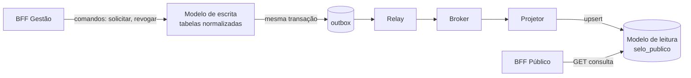

# CQRS no badge-service

Este documento descreve como o badge-service separa o modelo de escrita (emissão e revogação de selos) do modelo de leitura (consulta pública), como o modelo de leitura é mantido atualizado e qual defasagem é aceitável.

## 1. Por que aplicar CQRS neste serviço

O badge-service tem dois usos muito diferentes. A **escrita** (solicitar, emitir e revogar selo) é rara e cheia de regras de negócio. A **leitura** (o doador consultar se a ONG tem selo válido) é frequente, anônima e precisa ser rápida. Separar os dois modelos permite otimizar cada um sem que um atrapalhe o outro: um pico de consultas públicas não deve deixar a emissão de selos lenta.

| | Escrita (comando) | Leitura (consulta) |
|---|---|---|
| O que faz | Solicitar, emitir e revogar selo | Consultar se a ONG tem selo válido |
| Frequência | Rara | Muito frequente |
| Quem usa | Gestores e o próprio sistema | Qualquer pessoa, de forma anônima |
| O que importa | Regras de negócio corretas | Resposta rápida e simples |

O CQRS é aplicado apenas ao badge-service, que é o único serviço onde essa diferença entre leitura e escrita é significativa.

## 2. Modelo de escrita

Tabelas normalizadas no PostgreSQL do badge-service (solicitações de selo e selos emitidos), com as regras de negócio e os estados da emissão. É acessado pelos endpoints de escrita, como a solicitação de selo e a revogação. Toda mudança de estado grava, na mesma transação, um evento na tabela `outbox` (ver `docs/data-consistency.md`).

## 3. Modelo de leitura

Uma tabela separada, desnormalizada e pronta para consulta, sem junções:

| Campo | Descrição |
|---|---|
| ong_id | Identificador da ONG (chave primária) |
| id_selo | Identificador do selo vigente |
| nome_instituicao | Cópia do nome, vinda do org-service |
| status_conformidade | Por exemplo ATIVO ou REVOGADO |
| emitido_em | Data de emissão |

Ela é lida pelo `GET /v1/consulta/organizacoes/{ongId}`, que o BFF Público chama pela rede interna. Fica na mesma instância PostgreSQL do badge-service, em tabela própria, e a leitura nunca escreve nela. Os campos acima correspondem aos retornados pela consulta pública descrita em `docs/gateway-bffs.md`.

O `nome_instituicao` é uma cópia de um dado pertencente ao org-service. Isso evita uma chamada extra a cada consulta e mantém a consulta pública funcionando mesmo se o org-service estiver indisponível, ao custo de uma possível defasagem (ver `docs/data-consistency.md`, seção 2).

Esboço ilustrativo da tabela em SQL (PostgreSQL):

```sql
CREATE TABLE selo_publico (
  ong_id              UUID PRIMARY KEY,
  id_selo             UUID NOT NULL,
  nome_instituicao    VARCHAR(200) NOT NULL,
  status_conformidade VARCHAR(20) NOT NULL,
  emitido_em          TIMESTAMP NOT NULL
);
```

## 4. Como o modelo de leitura é atualizado

Um **projetor** consome os eventos publicados pela outbox e atualiza a tabela de leitura:

1. `SELO_GERADO` cria ou atualiza o registro da ONG com status ATIVO.
2. O evento de revogação (nome a confirmar, conforme `docs/saga.md`) altera o status para REVOGADO.
3. O evento de alteração do cadastro da ONG (nome a confirmar) atualiza o `nome_instituicao`.

A atualização é idempotente: é um upsert pela chave `ong_id`, então receber o mesmo evento duas vezes produz o mesmo resultado. Se o projetor ficar fora do ar, a consulta continua respondendo com o último estado conhecido, e ele reprocessa os eventos pendentes quando voltar.



## 5. Defasagem aceitável

Entre a mudança no modelo de escrita e o reflexo no modelo de leitura existe um intervalo, pois o evento passa pelo relay, pelo broker e pelo projetor.

| Situação | Defasagem aceitável |
|---|---|
| Emissão ou renovação de selo | até 5 segundos |
| Revogação de selo | até 2 segundos |
| Mudança de nome da ONG | até 1 minuto |

A revogação tem tolerância menor porque exibir como válido um selo já revogado é pior do que exibir um selo novo com pequeno atraso: o primeiro caso pode induzir um doador a confiar em uma ONG que perdeu o selo. Como a consulta é anônima e a emissão leva minutos dentro da SAGA, uma defasagem de poucos segundos não é percebida pelo doador. Em troca dessa pequena defasagem, a consulta pública responde rapidamente e não depende da disponibilidade dos demais serviços.
