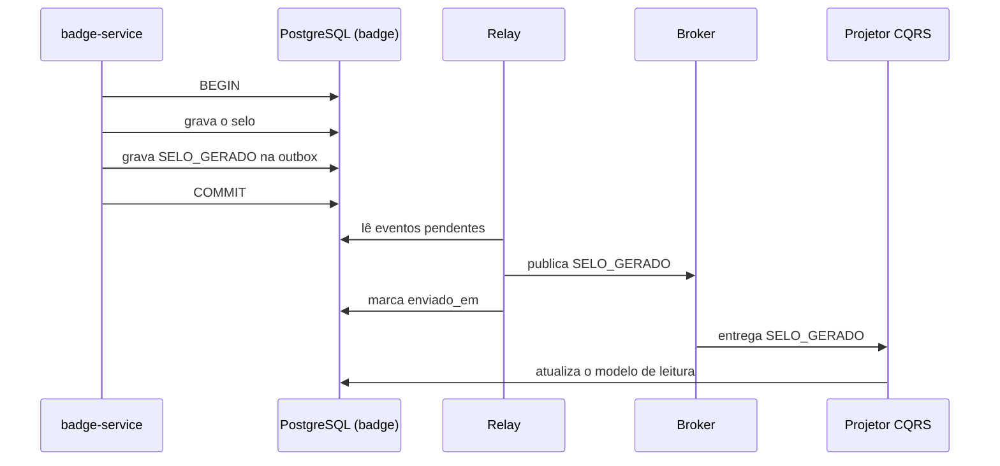

# Persistência, Consistência e Outbox

Este documento descreve onde cada microsserviço do ONGSec guarda seus dados e como o sistema mantém essas informações coerentes entre os serviços, mesmo sem uma transação única que as abranja.

## 1. Database per Service

Cada microsserviço possui uma instância própria de banco de dados. Nenhum serviço acessa diretamente o banco de outro: a troca de informações ocorre apenas por API REST ou por eventos. Com isso, cada serviço pode alterar a estrutura dos seus dados, ou ficar indisponível, sem derrubar os demais.

| Serviço | O que guarda | Tecnologia | Justificativa |
|---|---|---|---|
| org-service | ONGs, usuários e perfis de acesso | PostgreSQL (instância 1) | Dados de conta e login exigem transações ACID e integridade entre tabelas |
| audit-service | Questionários, respostas, diagnósticos e score | PostgreSQL (instância 2) | Colunas JSONB suportam questionários com perguntas de formato variável |
| task-service | Planos de ação e tarefas, com prazos e estados | PostgreSQL (instância 3) | Ciclo de vida de tarefas exige controle rigoroso de estados e relacionamentos |
| badge-service | Solicitações, selos emitidos e modelo de leitura público | PostgreSQL (instância 4) | Evita emissão duplicada de selos e atende à consulta pública de forma rápida |

Usar a mesma tecnologia nos quatro serviços não significa compartilhar banco: são quatro instâncias independentes. A tecnologia única simplifica a operação e a conteinerização nas etapas seguintes do projeto.

## 2. Consistência eventual

Como cada serviço tem seu próprio banco, não existe uma transação única que atualize todos ao mesmo tempo. Em alguns pontos, os dados ficam temporariamente diferentes entre serviços e convergem depois. Esses pontos são:

| Ponto | O que fica defasado | Por que é aceitável |
|---|---|---|
| SAGA de emissão do selo (Audit → Task → Badge) | Entre `DIAGNOSTICO_CONCLUIDO` e `SELO_GERADO`, a auditoria já está concluída, mas o selo ainda não existe | O processo é assíncrono, a solicitação de selo responde `202` (aceita) e a emissão continua na SAGA |
| Modelo de leitura do CQRS (badge-service) | O selo foi emitido ou revogado, mas a consulta pública ainda mostra o estado anterior | A defasagem máxima aceitável está definida em `docs/cqrs.md` |
| Nome da instituição no modelo de leitura | O org-service é dono do nome, mas o modelo de leitura guarda uma cópia que pode ficar desatualizada por um tempo | O nome muda raramente e a cópia é atualizada por evento |

## 3. Risco de dual write

Dual write é gravar em dois sistemas diferentes (o banco de dados e o broker de mensagens) sem uma transação que cubra os dois. Um pode dar certo e o outro falhar. Exemplo no ONGSec:

- O badge-service grava o selo no banco, mas cai antes de publicar `SELO_GERADO`. O selo existe, mas a consulta pública e a SAGA nunca ficam sabendo.
- O inverso: o evento é publicado, mas a gravação no banco falha. O sistema anuncia um selo que não existe.

Diferente da consistência eventual, que se corrige sozinha, esse tipo de falha deixa os dados inconsistentes de forma permanente, sem que nenhum erro seja percebido.

O risco aparece em todo serviço que altera o próprio banco e depois avisa outro serviço: audit-service (`DIAGNOSTICO_CONCLUIDO`), task-service (`TAREFAS_REMEDIADAS`) e badge-service (`SELO_GERADO` e `SELO_REVOGADO`).

## 4. Padrão Outbox

Para evitar o dual write, o serviço grava o dado de negócio e o evento **na mesma transação do próprio banco**, em uma tabela `outbox`. Um processo separado (relay) lê essa tabela e publica os eventos no broker.

**Fluxo de emissão do selo (badge-service):**

1. Na mesma transação, o serviço grava o selo e um registro `SELO_GERADO` na tabela `outbox`. Ou os dois são gravados, ou nenhum.
2. O relay lê os registros ainda não enviados e publica no broker.
3. Após a publicação, o relay marca o registro como enviado.
4. O consumidor (o projetor do modelo de leitura) recebe o evento e atualiza a consulta pública.



**Estrutura da tabela `outbox`:**

| Campo | Descrição |
|---|---|
| id | Identificador único do evento |
| tipo_evento | Nome do evento, por exemplo `SELO_GERADO` |
| ong_id | ONG à qual o evento se refere |
| payload | Conteúdo do evento em JSON |
| correlation_id | Identificador de rastreamento da requisição original |
| criado_em | Quando o evento foi gravado |
| enviado_em | Quando foi publicado (vazio enquanto pendente) |

Esboço ilustrativo da tabela em SQL (PostgreSQL):

```sql
CREATE TABLE outbox (
  id              UUID PRIMARY KEY,
  tipo_evento     VARCHAR(50) NOT NULL,
  ong_id          VARCHAR(50) NOT NULL,
  payload         JSONB NOT NULL,
  correlation_id  VARCHAR(100),
  criado_em       TIMESTAMP NOT NULL DEFAULT now(),
  enviado_em      TIMESTAMP NULL
);
```

**Entrega repetida:** se o relay cair depois de publicar e antes de marcar como enviado, o evento sai duas vezes. Por isso quem consome precisa ser idempotente: processar o mesmo evento duas vezes produz o mesmo resultado (o `id` do evento é usado para ignorar repetidos).

O broker de mensagens específico será definido na etapa de implementação; o padrão outbox funciona com qualquer um deles.
