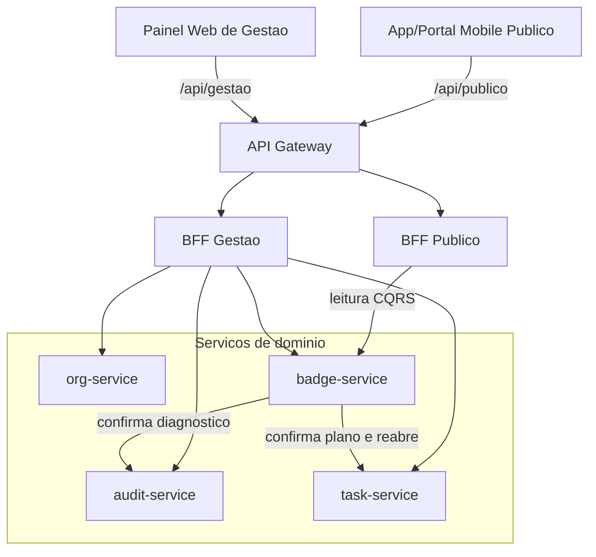

# Decomposição dos microsserviços — ONGSec

A plataforma ONGSec é cortada em **quatro microsserviços de domínio**, cada um com banco próprio. O critério do corte é a responsabilidade de negócio, não a camada técnica: cadastro, diagnóstico, remediação e certificação têm ciclo de vida, público e consistência diferentes.

O tráfego externo não chega nesses serviços. Ele entra pelo API Gateway e pelos dois BFFs, descritos em [`docs/gateway-bffs.md`](gateway-bffs.md). Os contratos HTTP de cada serviço estão em `docs/openapi/`. A transação que atravessa auditoria, remediação e certificação está em [`docs/saga.md`](saga.md).

## 1. Os quatro serviços

### 1.1 org-service — Gestão de entidades

Dono do cadastro da ONG, dos usuários gestores e da sessão. Emite o JWT que o gateway valida nas rotas `/api/gestao/*`.

**Responsabilidades**

- Cadastrar e atualizar a organização (`nome_instituicao`, CNPJ, `responsavel_legal`).
- Gerenciar usuários da ONG.
- Autenticar o gestor (`POST /v1/sessoes`) e encerrar a sessão.

**Fronteira.** Não aplica questionário, não abre plano de tarefas e não emite selo. O nome da instituição que aparece na consulta pública é uma **cópia** no modelo de leitura do badge-service, atualizada por evento; o org-service continua sendo o dono do cadastro.

### 1.2 audit-service — Auditoria

Dono do questionário de higiene digital, das respostas e do `score`. O BFF Gestão publica esse valor como `score_auditoria`.

**Responsabilidades**

- Servir o modelo de perguntas.
- Abrir o diagnóstico, gravar respostas e calcular o score na conclusão.
- Registrar o fato que a SAGA nomeia `DIAGNOSTICO_CONCLUIDO`.

**Fronteira.** Não cria tarefa e não publica certificado. Concluir o diagnóstico mede conformidade; não reserva selo. Por isso a compensação da SAGA não “desfaz” o score: o fato histórico permanece e a saga simplesmente não avança.

### 1.3 task-service — Remediação

Dono do plano de ação e das tarefas. Informa `tarefas_pendentes`, campo que o BFF Gestão inclui no detalhe do selo.

**Responsabilidades**

- Abrir o plano a partir de um diagnóstico concluído.
- Controlar prazo e estado de cada tarefa (`PENDENTE`, `CONCLUIDA`, `REABERTA`).
- Informar se ainda existe pendência que impede a certificação.
- Reabrir o plano quando a SAGA precisa compensar (`POST /v1/planos/{planoId}/reabertura`).

**Fronteira.** Não recalcula o score e não emite selo. A tarefa carrega HATEOAS (`self`, `plano`, `concluir`, `reabrir`) para o BFF descobrir a próxima ação sem montar URL à mão.

### 1.4 badge-service — Certificação

Dono da solicitação, do selo e da consulta pública. Também **orquestra** a SAGA de emissão: é o único serviço que já guarda `historico_saga_emissao` e responde `202` enquanto o selo ainda não está `ATIVO`.

**Responsabilidades**

- Aceitar a solicitação de selo.
- Confirmar, via os outros serviços, diagnóstico concluído e plano sem pendência.
- Emitir, revogar e compensar o selo.
- Servir a projeção CQRS em `GET /v1/consulta/organizacoes/{ongId}`.

**Fronteira.** Não altera score nem tarefa no banco alheio. Quando precisa compensar remediação, chama o task-service; não escreve na tabela de tarefas.

## 2. Por que este corte, e não outro

O enunciado pede a justificativa da fronteira. Os cortes abaixo foram considerados e recusados.

| Corte alternativo | Por que foi recusado |
|---|---|
| **Um serviço único** (ONG + auditoria + tarefas + selo) | Impede database per service, mistura cadastro frequente com emissão rara e impede isolar a leitura pública do CQRS. Uma falha no questionário derrubaria a consulta do doador. |
| **Juntar audit-service e task-service** | Diagnosticar e remediar são verbos diferentes. O diagnóstico é um documento com score; o plano é uma máquina de estados com prazo. Juntos, o serviço ficaria gordo e a SAGA perderia um passo compensável (`reabertura`) separado da medição. |
| **Juntar org-service e badge-service** | Login e cadastro mudam o tempo todo; o selo é emitido poucas vezes e é lido anonimamente. A consulta pública não pode depender da tabela de usuários. O nome da ONG é copiado para a projeção, justamente para o doador não chamar o org-service. |
| **Quinto serviço só de orquestração** | A solicitação já é o estado da SAGA (`SOLICITADA`, `SELO_EMITIDO`, `COMPENSADA`). Um orquestrador extra seria mais um banco e mais um ponto de *dual write*, sem dado de negócio novo. |
| **Cortar por camada** (serviço de API, serviço de persistência) | Isso não é fronteira de domínio. Todos os quatro serviços já expõem REST e já têm banco próprio. |

O org-service **não entra como passo mutável da SAGA**. Ele fornece identidade e o nome da instituição. A transação de negócio que o enunciado exige (três serviços) é **Audit → Task → Badge**.

## 3. Diagrama de componentes e comunicação

Há dois tipos de seta interna:

- **BFF → serviço:** composição da resposta do painel ou da consulta pública. Contratos em `docs/openapi/`.
- **badge-service → audit-service e task-service:** chamadas do orquestrador da SAGA. Não passam pelo gateway.

Nenhum serviço lê o banco do outro. Eventos (`DIAGNOSTICO_CONCLUIDO`, `TAREFAS_REMEDIADAS`, `SELO_GERADO`, `SELO_REVOGADO`) saem pela *outbox* do serviço que os produz; o padrão está em [`docs/data-consistency.md`](data-consistency.md).
