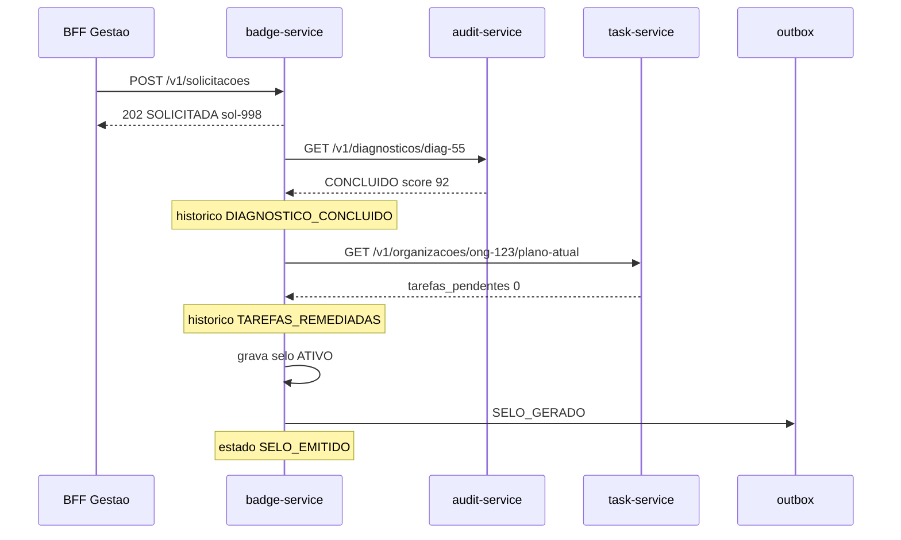
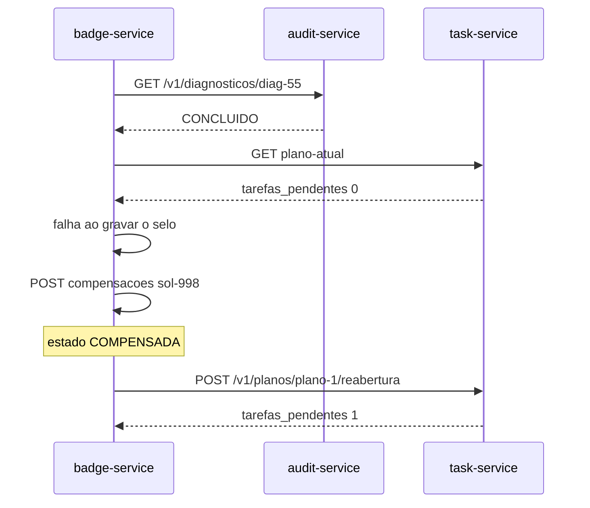

# SAGA de emissão do selo — ONGSec

A transação de negócio é a **emissão do Selo Digital de Conformidade**. Ela atravessa três serviços de domínio: `audit-service`, `task-service` e `badge-service`. Não existe uma transação ACID que cubra os três bancos; a consistência é explícita, com passos à frente e compensações à ré.

O exemplo usado em todo o repositório é a Associação Cuidar (`ong-123`), diagnóstico `diag-55`, plano `plano-1`, solicitação `sol-998` e selo `CERT-2026-998`.

## 1. Orquestrada, não coreografada

Adotamos **uma única variante: SAGA orquestrada**. O orquestrador mora no **badge-service**.

Esse serviço já é o dono da solicitação (`POST /v1/solicitacoes` responde `202`), já guarda `historico_saga_emissao` e já expõe `POST /v1/solicitacoes/{id}/compensacoes`. Colocar a coordenação nele evita um quinto microsserviço só para orquestrar.

A alternativa **coreografada** foi recusada. Nela, cada serviço publicaria um evento e o próximo reagiria sozinho: `DIAGNOSTICO_CONCLUIDO` dispararia o task-service, `TAREFAS_REMEDIADAS` dispararia o badge-service. Isso espalha a ordem dos passos, torna a compensação implícita e impede um único `GET /v1/solicitacoes/{id}` de responder “em que ponto a emissão parou”. A certificação é um fluxo linear, com dependência clara (não se emite selo com tarefa pendente) e com um gestor esperando o resultado. Orquestração deixa timeout, `Idempotency-Key` e a ordem inversa das compensações no mesmo lugar.

O API Gateway **não** orquestra. Ele só roteia e aplica JWT ou *rate limit*, como em [`docs/gateway-bffs.md`](gateway-bffs.md).

## 2. Pré-condições e início

Antes da SAGA, o caminho de uso já produziu dois fatos locais:

1. Dona Maria concluiu o diagnóstico: `POST /v1/diagnosticos/diag-55/conclusao` → `score = 92`, evento `DIAGNOSTICO_CONCLUIDO`.
2. O plano foi executado até `tarefas_pendentes = 0`. Quando a última tarefa conclui, o task-service registra `TAREFAS_REMEDIADAS`.

A SAGA **começa** quando o BFF Gestão chama `POST /v1/solicitacoes` com `ong_id`, `diagnostico_id` e `plano_id`. O badge-service grava a solicitação em `SOLICITADA` e devolve `202`. Daí o orquestrador confirma os dois fatos nos outros serviços e, só então, emite o selo.

Se o plano ainda tiver tarefa pendente ou o diagnóstico não tiver score, o `POST` responde `422` e a SAGA **nem abre**. Isso não é compensação: nenhum passo à frente foi aplicado.

## 3. Passos à frente

| Ordem | Serviço | O que o orquestrador faz | Sucesso | Evento no histórico |
|---|---|---|---|---|
| 1 | badge-service | `POST /v1/solicitacoes` | Solicitação `SOLICITADA`, HTTP `202` | — |
| 2 | audit-service | `GET /v1/diagnosticos/diag-55` | Status `CONCLUIDO` e `score` preenchido | `DIAGNOSTICO_CONCLUIDO` |
| 3 | task-service | `GET /v1/organizacoes/ong-123/plano-atual` | `tarefas_pendentes = 0` e `plano_id` igual ao informado | `TAREFAS_REMEDIADAS` |
| 4 | badge-service | grava o selo `ATIVO` na mesma transação da *outbox* | Solicitação `SELO_EMITIDO`, `id_selo = CERT-2026-998` | `SELO_GERADO` |

O projetor CQRS consome `SELO_GERADO` e atualiza a consulta pública. A defasagem aceitável está em [`docs/cqrs.md`](cqrs.md). O org-service não é passo da SAGA: o nome da instituição já está no cadastro e é copiado para a projeção.

Toda chamada de escrita leva `Idempotency-Key` e `X-Correlation-ID`, definidos em [`docs/api/versionamento.md`](api/versionamento.md). Repetir a mesma chave não abre segunda solicitação nem emite segundo selo.

## 4. Transações compensatórias

Cada passo que altera estado visível tem uma compensação. A ordem de desfazer é a inversa da ordem de fazer.

| Passo à frente | Compensação | Endpoint |
|---|---|---|
| Selo `ATIVO` já gravado | Revoga o selo; a consulta pública passa a `REVOGADO` | `POST /v1/selos/CERT-2026-998/revogacao` |
| Solicitação `SOLICITADA` ou `SELO_EMITIDO` | Marca a solicitação `COMPENSADA`. Se o selo existia, o status público também cai para `REVOGADO` | `POST /v1/solicitacoes/sol-998/compensacoes` |
| Plano considerado remediado | Reabre tarefas concluídas; `tarefas_pendentes` deixa de ser zero | `POST /v1/planos/plano-1/reabertura` |
| Diagnóstico `CONCLUIDO` | Nenhuma. O score é medição, não reserva. A saga interrompe; não apaga resposta nem zera o `score` | — |

A compensação do diagnóstico não existe de propósito. Desfazer o questionário mentiria o histórico de auditoria. O que se desfaz é o que foi **reservado ou publicado**: solicitação, selo público e o “plano limpo” que autorizou a emissão.

O evento de revogação, que o projetor CQRS consome, chama-se **`SELO_REVOGADO`**. É o nome que [`docs/cqrs.md`](cqrs.md) deixava em aberto.

## 5. Caminho feliz

Depois disso, `GET /api/publico/selos/ong-123` devolve o JSON enxuto do BFF Público. `GET /api/gestao/selos/ong-123/detalhes` agrega score, responsável legal, `tarefas_pendentes = 0` e o mesmo `historico_saga_emissao`. O mapa campo a campo está em [`docs/api/alinhamento-bff.md`](api/alinhamento-bff.md).

## 6. Falha com compensação

Cenário apresentado: o orquestrador já confirmou diagnóstico e plano. Na hora de gravar o selo, o badge-service recusa a emissão (falha de persistência ou regra que só se aplica nesse instante). O selo **não** fica `ATIVO`. O orquestrador desfaz o que já era visível: a solicitação deixa de parecer em andamento e o plano volta a ter pendência, para Dona Maria corrigir o que for preciso.

Não se chama revogação neste cenário: o selo nunca foi emitido. Não se altera o diagnóstico: o score `92` permanece.

Um segundo caso, depois do caminho feliz, é a **não conformidade reaberta** pela gestora ou pelo auditor. Aí o selo já existe:

1. `POST /v1/selos/CERT-2026-998/revogacao` → `REVOGADO` e evento `SELO_REVOGADO`.
2. `POST /v1/solicitacoes/sol-998/compensacoes` → `COMPENSADA`.
3. `POST /v1/planos/plano-1/reabertura` → o painel volta a mostrar tarefa pendente.

A consulta pública deixa de afirmar conformidade. A defasagem máxima dessa atualização está em [`docs/cqrs.md`](cqrs.md).
